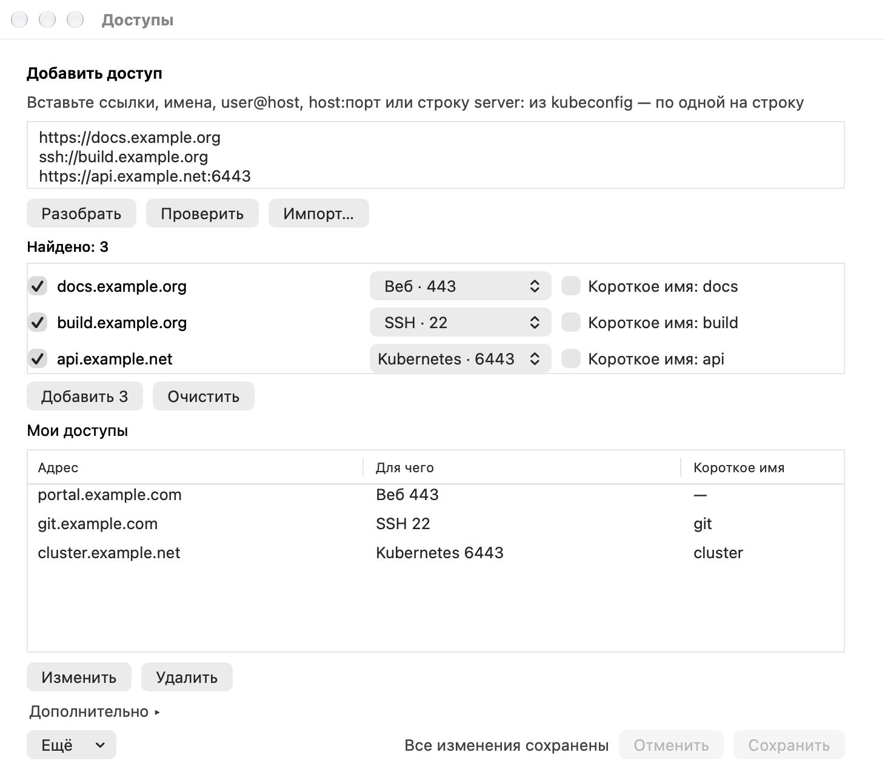

# Corporate VPN Router

Corporate VPN Router направляет выбранные рабочие адреса через Check Point на Mac. Остальной трафик идёт по обычному маршруту macOS, в том числе через личный VPN. Правила действуют в браузерах, SSH-клиентах, Lens и других приложениях, которые подключаются по DNS-имени и TCP.

## Скачать 0.3.26 by MichaelTG

Для **Mac с Apple Silicon и macOS 26+**. Обе сборки имеют одну версию. Рабочий профиль входит в «Красную».

| Сборка | Для кого |
| --- | --- |
| **[Чистая ↓](https://github.com/GeoKhv/corporate-vpn-router/releases/download/v0.3.26/Corporate-VPN-Router-0.3.26-CLEAN-macOS-arm64.zip)** | Вы сами добавляете рабочие адреса и используете настроенный в официальном Check Point шлюз. В ZIP нет готового профиля, закреплённых сертификатов организации или рабочего списка. [SHA-256](https://github.com/GeoKhv/corporate-vpn-router/releases/download/v0.3.26/Corporate-VPN-Router-0.3.26-CLEAN-macOS-arm64.zip.sha256) |
| **[Красная ↓](https://github.com/GeoKhv/corporate-vpn-router/releases/download/starter-v0.3.26/Corporate-VPN-Router-0.3.26-STARTER-work-sites-macOS-arm64.zip)** | Стартовый комплект с готовыми рабочими сайтами, включая Superset и «Метрику», и проверенными параметрами подключения. [SHA-256](https://github.com/GeoKhv/corporate-vpn-router/releases/download/starter-v0.3.26/Corporate-VPN-Router-0.3.26-STARTER-work-sites-macOS-arm64.zip.sha256) |

Для обновления нажмите **«Проверить обновления» → «Загрузить и установить»**. Sparkle сохраняет действующий профиль. С 0.3.24 и 0.3.25 он предлагает сразу 0.3.26. Стартовые правила, включая Superset и «Метрику», можно получить из «Красного» ZIP. [Установка, обновление и откат](docs/COLLEAGUES.ru.md)

## Как пользоваться

1. Распакуйте ZIP, откройте Router и нажмите **«Установить и открыть»**. При первом запуске macOS может запросить отдельное разрешение.
2. Откройте **«Доступы…»**, чтобы проверить рабочие правила. Чтобы добавить адреса, вставьте их списком, нажмите **«Разобрать»**, проверьте полное имя и порт, затем нажмите **«Добавить» → «Сохранить»**. При изменении разрешений macOS покажет подтверждение помощника маршрутов.
3. Нажмите **«Подключить»** в приложении или меню. Войдите с кодом и паролем либо ключом доступа в браузере, если выбранный SSL-профиль его поддерживает.

### Главное окно

### Доступы

На скриншотах используются демонстрационные адреса. Поисковые суффиксы помогают редактору найти полное имя через корпоративный DNS. В обычных приложениях короткое имя работает через сохранённый алиас после применения правил.

## Подробнее

- [Подключение и диагностика](docs/COLLEAGUES.ru.md)
- [Как устроены маршруты и защита при обрыве](docs/ARCHITECTURE.md)
- [Сборка](docs/BUILDING.ru.md) · [История выпусков](CHANGELOG.md) · [Компоненты и лицензии](ThirdParty/README.md)

Новый экран «Доступы» и обновлённое меню сделал [MichaelTG](https://github.com/MichaelTG). [PR №4](https://github.com/GeoKhv/corporate-vpn-router/pull/4)
