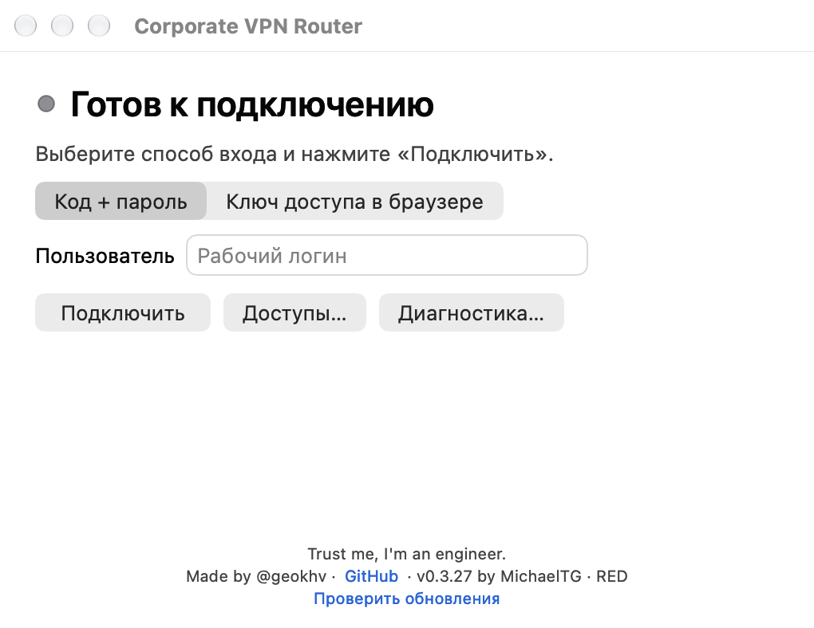

# Corporate VPN Router

Corporate VPN Router направляет выбранные рабочие адреса через Check Point на Mac. Остальной трафик идёт по обычному маршруту macOS, в том числе через личный VPN. Правила действуют в браузерах, SSH-клиентах, Lens и других приложениях, которые подключаются по DNS-имени и TCP.

## Скачать 0.3.45 by MichaelTG

Исправлена потеря доступа к рабочим сайтам при длительном подключении. Router освобождает соединения после проверки DNS и ошибок TCP. Если локальный прокси перестаёт отвечать, в меню и главном окне появляется кнопка «Переподключиться». После нажатия Router запускает новый вход.

В RED доступ к ПУРМС настраивается при подключении. Router использует готовый адрес и сохраняет ранее настроенный рабочий ПК. При первом подключении или обновлении разрешений достаточно подтвердить запрос macOS. Ввод имени ПК остаётся доступен при ручном редактировании. VDI через VMware Horizon открывается по обычному маршруту macOS.

Для **Mac с Apple Silicon и macOS 26+**. У RED и WHITE одинаковый номер версии. У каждой редакции свой канал обновлений.

| Сборка | Для кого |
| --- | --- |
| **[WHITE · чистая ↓](https://github.com/GeoKhv/corporate-vpn-router/releases/download/v0.3.45/Corporate-VPN-Router-0.3.45-CLEAN-macOS-arm64.zip)** | Вы сами добавляете рабочие адреса и используете настроенный в официальном Check Point шлюз. В ZIP нет готового профиля, закреплённых сертификатов организации или рабочего списка. [SHA-256](https://github.com/GeoKhv/corporate-vpn-router/releases/download/v0.3.45/Corporate-VPN-Router-0.3.45-CLEAN-macOS-arm64.zip.sha256) |
| **[RED · рабочая ↓](https://github.com/GeoKhv/corporate-vpn-router/releases/download/starter-v0.3.45/Corporate-VPN-Router-0.3.45-STARTER-work-sites-macOS-arm64.zip)** | Стартовый комплект с готовыми рабочими сайтами, включая Superset и «Метрику», и проверенными параметрами подключения. [SHA-256](https://github.com/GeoKhv/corporate-vpn-router/releases/download/starter-v0.3.45/Corporate-VPN-Router-0.3.45-STARTER-work-sites-macOS-arm64.zip.sha256) |

Если 0.3.34 или 0.3.35 сообщает об ошибке подготовки обновления, завершите отключённый Router, распакуйте ZIP своей редакции и откройте приложение из архива. Штатный Check Point может продолжать работу.

В уже установленном Router нажмите **«Проверить обновления» → «Загрузить и установить»**. Установки до разделения получат RED, включая новые правила Superset и «Метрики». Новые установки WHITE получают обновления из отдельного канала. Если Router уже нашёл версию, в окне установки можно нажать «Проверить снова». [Установка, обновление и откат](docs/COLLEAGUES.ru.md)

## Как пользоваться

1. Распакуйте ZIP, откройте Router и нажмите **«Установить и открыть»**. При первом запуске macOS может запросить отдельное разрешение.
2. Откройте **«Доступы…»**, чтобы проверить рабочие правила. Чтобы добавить адреса, вставьте их списком, нажмите **«Разобрать»**, проверьте полное имя и порт, затем нажмите **«Добавить» → «Сохранить»**. При изменении разрешений macOS покажет подтверждение помощника маршрутов.
3. Нажмите **«Подключить»** в приложении или меню. Войдите с кодом и паролем либо ключом доступа в браузере, если выбранный SSL-профиль его поддерживает.

Если рабочий сайт не открывается при подключённом VPN, нажмите **«Не открывается рабочий сайт? Проверить адрес…»**. Вставьте ссылку на проблемный сайт. Результат появится в диагностике в строке «DNS macOS». При подтверждённой ошибке DNS нажмите «Восстановить DNS и проверить сайт» в окне диагностики. Router повторно проверит адрес, запросит разрешение macOS на обновление системного DNS и покажет результат проверки того же сайта.

### Главное окно

### Доступы

На скриншотах используются демонстрационные адреса. Поисковые суффиксы помогают редактору найти полное имя через корпоративный DNS. В обычных приложениях короткое имя работает через сохранённый алиас после применения правил.

## Подробнее

- [Подключение и диагностика](docs/COLLEAGUES.ru.md)
- [Как устроены маршруты и защита при обрыве](docs/ARCHITECTURE.md)
- [Сборка](docs/BUILDING.ru.md) · [История выпусков](CHANGELOG.md) · [Компоненты и лицензии](ThirdParty/README.md)

Новый экран «Доступы» и обновлённое меню сделал [MichaelTG](https://github.com/MichaelTG). [PR №4](https://github.com/GeoKhv/corporate-vpn-router/pull/4)
