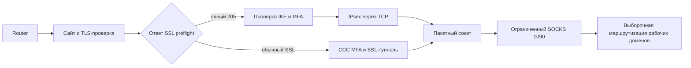

# Архитектура 0.3.19

## Поток подключения

AppKit-приложение проверяет выбранный сайт Check Point, закреплённую идентичность и доступные способы входа. Если уже работает официальный сеанс, переключение требует согласия. Затем начинается отдельная попытка Router с новым MFA; приложение не воспроизводит прошлые секреты.

## Доверие и выбор сайта

`Backend/trust.py` и `Backend/tls_policy.py` проверяют конфигурацию официального клиента, доверенную цепочку, имя TLS и закреплённую идентичность. Несколько записей не являются ошибкой сами по себе, но выбор не должен соединять логин с произвольным сайтом. Поддержанная привязка альтернативного сайта сохраняет его собственную идентичность. Изменение IP не означает, что можно отказаться от проверки сертификата.

Свежая конфигурация способов входа получается по проверенному TLS. В режиме кода/пароля выбирается поддерживаемый двухфакторный профиль. Для общего `password:` IPsec-интерфейс использует подпись того же фактора из выбранного профиля, сохраняя позиции отсутствующих подписей. Конкретный динамический запрос шлюза имеет приоритет.

## Два транспорта

SSL использует существующие CCC/SLIM и cpyvpn. При наличии отдельно включённого `cvr-ipsec` только явный SSL-отказ 205 в проверенном preflight выбирает IPsec. Ошибка TLS не служит поводом пробовать другой способ доверия.

IPsec-модуль — изолированная производная snx-rs/isakmp, IKEv1 через TCPT. IKE-сертификат и подпись проверяются до запросов секретов. Ключи, адрес и DNS получаются из авторизованного IKE-сеанса. Модуль не создаёт системный VPN, не меняет маршруты/DNS и не заявляет фиктивное соответствие SCV. Неиспользуемый запрос CCC ClientSettings удалён в 0.3.18. Подробнее: [лицензия, изменения и сборка модуля](../ThirdParty/ipsec-bridge/README.md).

Пакеты передаются существующему ограниченному SOCKS через Unix datagram socket. Перед активацией маршрутов проверяются SOCKS handshake и владелец слушателя. Отмена, ошибка или потеря родителя закрывает процессы данной попытки. Пароли и OTP передаются через анонимные каналы, не через аргументы команд и не через файлы.

## Выборочная маршрутизация

В отличие от исторической beta.6, ветка 0.3 использует selective TUN: sing-box и узкий привилегированный помощник обслуживают утверждённые рабочие правила. Обычное подключение не переустанавливает помощник. Личные назначения продолжают использовать текущий обычный маршрут, включая внешний VPN. Нельзя переносить утверждение «системные маршруты не меняются» из описания старого SOCKS-модуля на всё приложение 0.3.

Помощник ограничивает операции, проверяет клиента, хранит локально утверждённую политику и убирает собственные изменения при остановке. Исходники root-helper, его доставленный пакет и реально установленная версия — разные состояния; новая app не доказывает обновления службы на Mac. SOCKS-доступ локальных процессов ограничен профилем, но враждебный локальный пользователь не входит в модель защиты.

## Диагностика и обновления

Статусы авторизации, VPN-туннеля, SOCKS, DNS и одного HTTPS-адреса независимы. Диагностический GET ограничен по времени и размеру. HTTP-ответ с проверенным TLS подтверждает транспортную доступность, а не вход пользователя в сайт. В общий отчёт экспортируются типизированные поля и коды; свободный текст ответа и секреты исключаются. Копирование отчёта использует file URL в системном буфере после успешного сохранения.

Sparkle проверяет Ed25519-подписи ленты и ZIP. Установка требует явного действия, резервной копии и подтверждённой очистки текущей попытки. [Подробности обновления и отката](UPDATES.ru.md). [Архив архитектуры beta.6](archive/ARCHITECTURE-beta6.md).
