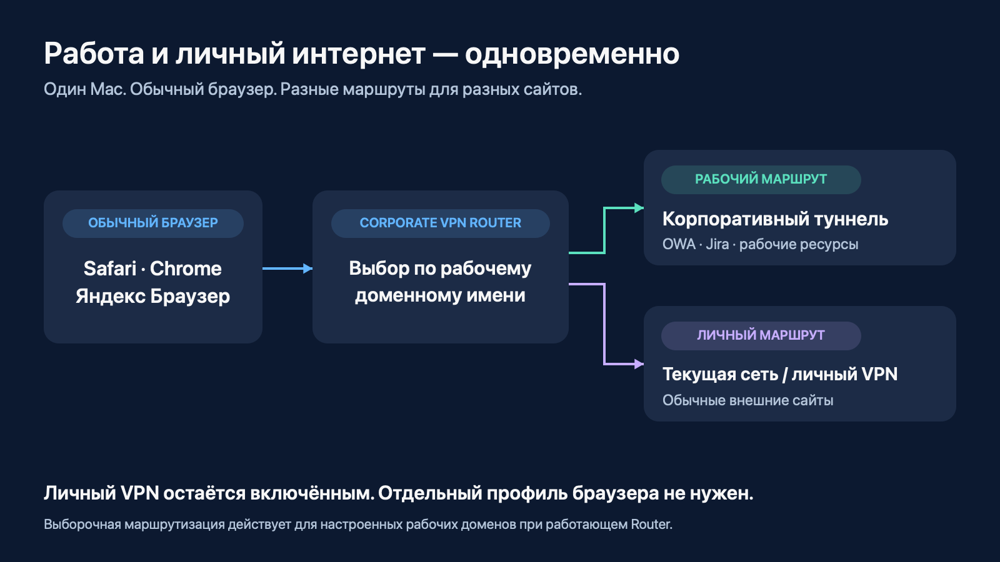
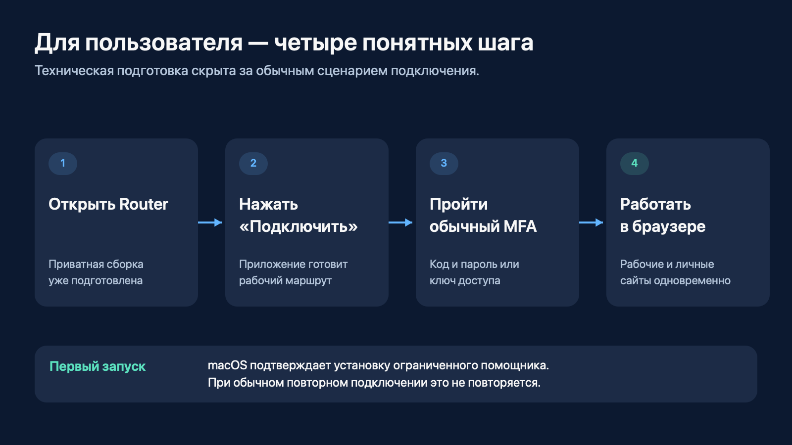
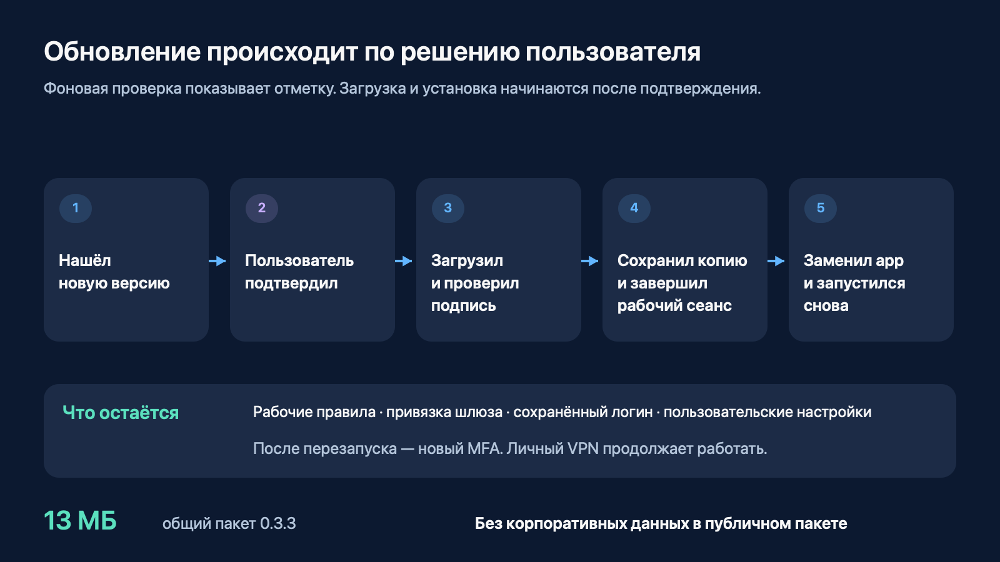
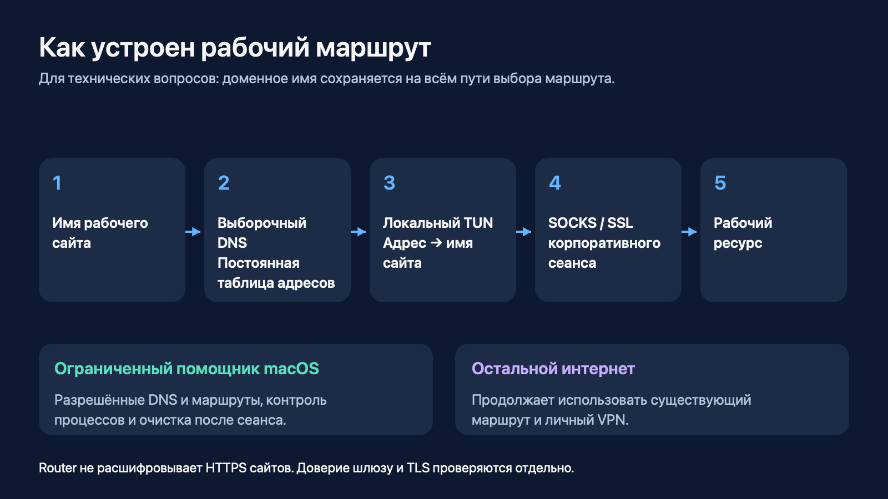

# Corporate VPN Router

## Рабочие сайты и личный интернет — одновременно

**Версия 0.3.3 · Материал для выступающего · 12 ноября 2026**

Главная мысль: **открываем рабочие ресурсы в привычном браузере, сохраняя личный VPN включённым.** Router выбирает маршрут по настроенным рабочим доменам, помогает подключиться и поддерживает обновления без неожиданной остановки работы.

**Как пользоваться этим файлом:** основной рассказ и мини-демонстрация рассчитаны на 7–10 минут. Текст в цитатах можно произносить почти дословно. Остальное — подсказки выступающему. FAQ нужен для обсуждения после показа, читать его подряд не надо. Схемы — поясняющие иллюстрации устройства приложения и пользовательского сценария.

**Быстрый переход:** [рассказ](#talk) · [демонстрация](#demo) · [вопросы](#faq) · [техническая схема](#inside) · [шпаргалка](#cheatsheet) · [материалы проекта](#files).

---

## 1. Начало: какую задачу решаем — 45 секунд

> Покажу небольшое приложение для Mac, которое решает очень конкретную задачу. Мне нужно одновременно пользоваться рабочими сайтами и личным интернетом. При этом личный VPN уже включён, в браузере открыты нужные вкладки, и каждый раз переключать всю сеть неудобно.
>
> Corporate VPN Router позволяет оставить этот сценарий привычным. Рабочие сайты получают корпоративный маршрут. Остальной интернет продолжает идти через текущую сеть и личный VPN.
>
> Для пользователя это одно окно, кнопка подключения и обычный вход с MFA. Дальше можно открывать рабочую почту и Jira в своём браузере.

**Показать:** первую схему. Провести рукой или курсором от браузера к двум веткам. На этом этапе не объяснять DNS, TUN и root-helper: аудитории сначала нужен результат.

## 2. Что умеет Router — 1 минута

> Здесь для меня важны четыре вещи.
>
> Первая — рабочие и личные сайты доступны одновременно. Личный VPN продолжает работать.
>
> Вторая — обычный браузер. В текущей схеме не нужен специальный профиль Chrome: можно пользоваться привычным окном Safari, Chrome или Яндекс Браузера.
>
> Третья — понятное подключение. Приложение помнит логин и настройки, а новый рабочий сеанс начинается с нормального входа с MFA. Можно использовать код и пароль или ключ доступа через браузер, если этот способ доступен для учётной записи.
>
> Четвёртая — приложение можно обновлять. Оно само проверяет наличие новой версии, но решение о загрузке и установке остаётся у пользователя. Рабочая сессия не заканчивается только потому, что вышел новый релиз.

| Возможность | Что это даёт пользователю |
|---|---|
| Маршрут по рабочим доменам | Рабочие сайты получают свой путь, личный интернет сохраняет существующий |
| Обычный браузер | Можно оставить привычные вкладки и профиль |
| Сохранённые логин и настройки | При повторном запуске не надо заново собирать конфигурацию |
| Новый MFA для нового сеанса | Вход остаётся осознанным действием пользователя |
| Встроенные обновления | Не нужно вручную переносить настройки в каждую новую версию |
| Очистка после сеанса | Приложение освобождает созданные им маршруты и DNS |

## 3. Как выглядит начало работы — 45 секунд

> Коллеге передаётся приватный архив с уже подготовленным приложением. Он устанавливает его в папку приложений, открывает и проходит первичную подготовку.
>
> Для работы с сетевыми маршрутами macOS один раз запрашивает установку системного помощника. Дальше обычный сценарий короткий: открыть Router, нажать «Подключить», пройти MFA и работать.
>
> В окне виден статус подключения. Есть переход к рабочим сайтам и диагностика. Когда работа закончена, кнопка «Отключить» завершает корпоративный сеанс и убирает его сетевые настройки. Личный VPN остаётся включённым.

**Показать:** настоящее окно Router. Не открывать диагностику без вопроса — она отвлечёт от пользовательского сценария.

## 4. Мини-демонстрация — 2–3 минуты

### Подготовить до начала

- Оставить Router 0.3.3 подключённым и личный VPN включённым.
- Подготовить в обычном браузере три вкладки: OWA, Jira и внешний HTTPS-сайт без чувствительного содержимого. Для рабочих ресурсов выбрать экран, который допустимо показывать аудитории.
- Закрыть лишние окна и включить режим без уведомлений, чтобы в трансляцию не попали сообщения.
- Открыть этот файл или `index.html` и схемы. Демонстрировать окно приложения и нужные вкладки, а не весь рабочий стол.

### Последовательность показа

| Время | Действие | Что сказать | Что должна увидеть аудитория |
|---|---|---|---|
| 0:00–0:20 | Показать статус личного VPN, затем окно Router | «Личный VPN включён. Корпоративный сеанс тоже подключён. Сейчас оба сценария работают рядом». | Статусы двух работающих подключений |
| 0:20–0:55 | Открыть и обновить безопасную страницу OWA | «Открываю рабочую почту в обычном браузере. Переключать сеть для этого не нужно». | Загрузку рабочего ресурса |
| 0:55–1:25 | Перейти в Jira, обновить допустимый для показа экран | «Теперь второй рабочий ресурс. Это тот же браузер и тот же сеанс». | Загрузку второго рабочего ресурса |
| 1:25–1:50 | Обновить внешний HTTPS-сайт | «И рядом работает личный интернет. Личный VPN я не отключал». | Открытие внешнего сайта |
| 1:50–2:20 | В Router нажать «Проверить обновления» | «Проверка доступна вручную. Если новая версия появится, приложение сообщит об этом; устанавливать её сразу не обязательно». | Результат проверки. Для актуальной 0.3.3 отсутствие новой версии нормально |
| 2:20–2:40 | Показать пункт «Проверять обновления автоматически» в меню, не менять настройку | «Можно оставить проверки при запуске и раз в сутки или отключить их и проверять вручную». | Управление автопроверкой |
| 2:40–3:00 | Вернуться к схеме обновления | «Сам переход между версиями уже выполнен. Покажу, что происходит при установке». | Схему следующего раздела |

**Заметка для выступающего.** Наличие открытых страниц показывает пользовательский результат. Точный выбор маршрута подтверждался отдельно диагностикой; открытая вкладка сама по себе не является доказательством сетевого пути.

**Если времени только минута:** окно Router → обновить OWA → обновить внешний сайт → одна фраза про обновления. Jira и меню можно пропустить.

**Если хотят увидеть сам вход:** выделить ещё 1–2 минуты. Штатно отключить Router, дождаться завершения, снова нажать «Подключить» и пройти новый MFA. Пароль и код вводить вне демонстрации экрана. Для основного короткого показа достаточно уже работающего сеанса.

**Если страница задержалась:** один раз повторить открытие. Если не помогло, сказать: «В этой сети сейчас задержка. Покажу устройство сценария и зафиксированный результат, а соединение проверю отдельно». Перейти к схеме. Во время выступления не менять сертификаты, не запускать переустановку и не повторять MFA бесконечно.

## 5. Как работают обновления — 1 минута

> Обновления встроены через Sparkle — механизм обновлений для macOS. Приложение проверяет постоянный HTTPS-канал на GitHub. Для этого рабочий туннель не нужен.
>
> Автоматическая проверка показывает отметку в существующем окне или меню. Загрузка начинается после действия пользователя. Перед установкой пакет проходит криптографическую проверку подписи.
>
> Затем Router делает резервную копию, завершает свой рабочий сеанс, освобождает маршруты и DNS и только после этого разрешает замену приложения. Новая версия запускается из той же папки. Рабочие правила, привязка шлюза, логин и пользовательские настройки остаются на месте.
>
> После обновления нужен новый вход с MFA. Личный VPN всё это время продолжает работать.

**Один конкретный пример для рассказа:**

> Сегодня на первом Mac мы прошли два настоящих перехода через опубликованный канал: с 0.3.0 на 0.3.1 и затем на 0.3.3. После установки приложение запустилось из прежней папки, настройки сохранились, и я заново успешно подключился. Общий пакет 0.3.3 занимает около 13 мегабайт.

На сцене достаточно показать проверку и объяснить установку по схеме. На последней версии не будет предложения обновиться на саму себя. Полный переход уже подтверждён отдельным протоколом.

## 6. Завершение — 30 секунд

> Получился простой повседневный сценарий: запускаю Router, прохожу MFA и работаю с корпоративными сайтами в обычном браузере. Личный VPN остаётся включённым.
>
> Для первых коллег подготовлен приватный архив. Следующие версии приходят через встроенное обновление и сохраняют индивидуальную настройку. Пользователь сам выбирает момент установки.
>
> Теперь могу показать конкретный сценарий или ответить на вопросы — про подключение, маршруты, безопасность и обновления.

---

## Ответы на ожидаемые вопросы

### Пользовательский сценарий

**1. Зачем это нужно, если Check Point уже установлен?**

Router добавляет удобный сценарий выборочной работы: настроенные корпоративные сайты идут через рабочий сеанс, а остальной интернет сохраняет текущий маршрут. Официальный Check Point остаётся установленным и используется при подготовке и проверке доверия шлюзу. Во время работы Router не требуется поднимать параллельно полный туннель официального клиента.

**2. Это два VPN одновременно? Они не конфликтуют?**

В показанном сценарии одновременно работают личный VPN и отдельный корпоративный сеанс Router. Router добавляет адресные маршруты для выбранных рабочих ресурсов, сохраняя существующий маршрут остального интернета. Совместная работа с Sota проверена на первом Mac; для другой комбинации клиентов разумно повторить тот же короткий сценарий.

**3. Можно пользоваться своим браузером, закладками и вкладками?**

Да. Текущий механизм работает через сетевые настройки macOS для выбранных доменов. Отдельный профиль Chrome и ручной прокси для обычного показа не нужны. Сценарий рассчитан на обычное разрешение имён через систему; собственный DNS в приложении может потребовать отдельной проверки.

**4. Какие ресурсы показываем? А Confluence?**

В основном показе — OWA и Jira вместе с внешним HTTPS-сайтом. Для Confluence остаётся отдельный вопрос доступности, поэтому его не включаем в список подтверждённых результатов этой версии. Маршрутизация настраивается по рабочим доменам, но доступность конкретного сервиса проверяется отдельно.

**5. Нужно вводить пароль каждый раз? Что сохраняется?**

Сохраняются логин и пользовательская конфигурация. Для нового рабочего сеанса нужен новый вход с MFA. Router не воспроизводит сохранённые пароль и одноразовый код после обновления или переподключения. Доступны предусмотренные интерфейсом способы входа: код с паролем и ключ доступа в браузере.

**6. Что надо сделать коллеге при первой установке?**

Получить приватный подготовленный архив, распаковать приложение и установить в `/Applications` или `~/Applications`. При первой подготовке подтвердить системного помощника и пройти новый MFA. Официальный Check Point должен оставаться установленным и готовым. Общий ZIP из публичного релиза предназначен для обновления уже подготовленного Router.

**7. Каждый раз нужен пароль администратора?**

Нет, при обычном повторном подключении помощник уже установлен. Администратор нужен для первичной установки или реального восстановления системного компонента. Отдельный запрос при замене приложения в защищённой `/Applications` зависит от владельца и прав папки.

**8. Работает с AdGuard?**

На втором Mac с включённым AdGuard предыдущая проверенная основа прошла два полных рабочих сеанса и переподключение: корпоративные DNS, OWA, Jira и личный HTTPS работали. Эти сетевые механизмы сохранены в 0.3.3. Сам новый механизм обновлений на втором Mac проверяется отдельно; результат первого Mac мы на него не переносим.

**9. Можно добавить ещё рабочий сайт?**

Рабочие правила задают, какие домены обслуживает Router. Новый ресурс надо включать вместе с его необходимыми доменами и проверять доступ. Это изменение конфигурации, а не обещание, что любой введённый URL автоматически станет доступен.

**10. Будет ли работать быстрее?**

Основная выгода — одновременный доступ и меньше ручных переключений. Скорость зависит от сети, личного VPN, шлюза и сервиса. Универсального прироста скорости мы не обещаем. Ограниченный повтор отдельных неудачных TCP-подключений помогает пережить часть временных отказов без повторения аутентификации.

### Безопасность и устройство

**11. Это обход MFA или корпоративных прав?**

Вход с MFA сохраняется, права на рабочие ресурсы определяются корпоративной учётной записью и шлюзом. Router меняет локальную организацию маршрутов. Допустимость такого клиента в организации — отдельный вопрос согласования; успешная техническая демонстрация не означает корпоративную сертификацию.

**12. Router читает содержимое HTTPS-сайтов?**

Он видит нужные для маршрутизации доменные имена и сетевые соединения, но не расшифровывает HTTPS-содержимое сайтов и не подменяет их сертификаты. Доверие к корпоративному шлюзу и проверка TLS выполняются отдельно. Интеграция обновлений не переустанавливает сертификаты и не меняет доверие в Keychain.

**13. Зачем системный помощник с root-правами?**

macOS требует повышенных прав для установки выбранных маршрутов и DNS. Поэтому эти операции выполняет небольшой системный помощник с ограниченным интерфейсом. Он проверяет пользователя и точную подпись разрешённого клиента, выполняет предусмотренные сетевые действия и очистку. Возможности передать ему произвольную команду от root не добавлялись.

**14. Куда пойдёт рабочий запрос, если корпоративный сеанс оборвётся?**

Пока выборочная маршрутизация активна, рабочий запрос не переключается автоматически на личный путь при отказе корпоративного транспорта. При полном завершении Router его маршруты и DNS удаляются. Это защита активного рабочего сценария, а не постоянно действующий запрет любых корпоративных запросов во всей системе.

**15. Работают все приложения и все протоколы?**

Основной подтверждённый сценарий — рабочий TCP/HTTPS с настроенными доменами. Системная маршрутизация позволяет выйти за рамки одного браузера, но это не обещание поддержки любого сетевого стека. Прямые IP, UDP/QUIC, собственный DoH и Private Relay требуют отдельного рассмотрения.

**16. Почему собственный клиент, а не настройка split tunneling в Check Point?**

Если организация предоставляет подходящий поддерживаемый режим официального клиента, его стоит рассматривать первым. Здесь решается уже имеющийся сценарий на конкретной конфигурации Mac: отдельные рабочие домены рядом с личным VPN. Router использует самостоятельный SSL-транспорт с сохранённой доверенной привязкой шлюза и узкую локальную маршрутизацию. Это не официальный продукт Check Point.

**17. Что происходит после сбоя или завершения приложения?**

У помощника есть контроль жизненного цикла и очистка созданных Router сетевых настроек. При штатном отключении приложение ждёт завершения своих процессов. Перед обновлением дополнительно получает от помощника независимое подтверждение, что активных маршрутов и незавершённой очистки не осталось. Если это не подтверждено, замена приложения отменяется.

**18. Почему приложение ещё вызывает предупреждение macOS?**

Сборка имеет ad-hoc подпись, но не Developer ID и notarization. Поэтому при первом открытии возможен штатный запрос разрешения macOS. Подпись обновления защищает происхождение пакета и не заменяет доверие Apple к издателю. Gatekeeper и другие механизмы macOS ради установки не отключаются.

### Обновления и распространение

**19. Оно может внезапно обновиться посреди работы?**

Нет. Автоматически выполняется только проверка при запуске и затем раз в сутки, если она включена. О новой версии сообщает отметка. Загрузка и установка начинаются после явного действия пользователя с предупреждением о завершении рабочего сеанса. Автопроверку можно выключить; ручная остаётся доступной.

**20. Откуда приходит обновление? Нужен рабочий VPN или GitHub-аккаунт?**

Из постоянной публичной HTTPS-ленты и пакетов GitHub Releases. Рабочий туннель и авторизация GitHub не нужны; в клиенте нет общего GitHub-токена. Доступность зависит от обычного доступа к GitHub в текущей сети. Неудачная проверка сама по себе не завершает рабочий сеанс.

**21. Почему можно публиковать обновление, если приложение корпоративное?**

Разделены код и частная подготовка. Первый архив передаётся приватно: в нём есть необходимые корпоративные настройки. Они сохраняются локально вне `.app`. Последующие общие пакеты содержат обновляемое приложение без корпоративных доменов, шлюза, CA и приватной политики помощника. Публикации предшествует проверка состава.

**22. Как защищаемся от подмены обновления?**

Лента и пакеты подписаны Ed25519; в приложении только публичный ключ. Пакет проверяется до распаковки. Закрытый ключ находится в Keychain машины выпуска. Настоящий пакет с неправильной подписью был отвергнут в тесте реального Sparkle, до запуска установки.

**23. У всех будет окно «generate_appcast хочет использовать закрытый ключ»?**

Нет. Это запрос на машине выпуска, когда автор подписывает новую версию. На компьютерах коллег нет закрытого ключа и утилита `generate_appcast` для получения обновлений не запускается. Пользовательское приложение проверяет подпись публичным ключом. Системные запросы на установку помощника или доступ к защищённой папке — отдельные случаи.

**24. Настройки не потеряются? Не появится вторая копия?**

Sparkle заменяет текущую `.app` в её исходной папке. Поддерживаются `/Applications` и `~/Applications`. Конфигурация хранится отдельно, в Application Support, и сохраняется между версиями. При реальном переходе и новом MFA совпали все 19 проверенных контрольных сумм настроек, частной подготовки и помощника.

**25. Что будет при отмене, обрыве загрузки или ошибке установки?**

При отмене и обрыве загрузки установка не начинается, исходное приложение сохраняется. Перед заменой делается точная резервная копия. Отдельно проверен отказ финального перемещения файлов: старое приложение восстановилось в исходный путь, повторная установка прошла успешно. Откат вручную выполняется после штатной остановки, возвратом сохранённой `.app` в прежнюю папку, без замены пользовательских данных.

**26. Почему установка раньше шла долго? Сколько теперь ждать?**

Первый общий пакет занимал около 69 МБ; его загрузка в той сети заняла около пяти минут. В 0.3.3 удалены две неиспользуемые копии адаптера из общего пакета, и размер уменьшился примерно до 13 МБ. В последнем тесте загрузка до передачи проверенного пакета на распаковку заняла около 2,7 секунды. Это измерение одного запуска, не обещание времени всей установки в любой сети.

**27. Обновляется ли системный помощник вместе с приложением?**

Текущие совместимые обновления сохраняют установленного помощника, его разрешённые операции и проверку подписи клиента. Они не переустанавливают root-компонент через Sparkle. Изменение самого помощника потребует отдельного решения и объяснённого системного подтверждения.

**28. Как выпускать следующую версию?**

Собрать следующий номер, например 0.3.4, проверить состав общего пакета и совместимость помощника, подписать существующим ключом. Сначала опубликовать проверенный архив, затем подписанную ленту. Пройти обновление с предыдущей версии, проверить настройки и новый вход. Точные команды сохранены в инструкции выпуска; GitHub Actions для этого не используются.

**29. Можно прямо сейчас раздавать всем и на любые Mac?**

Для первых коллег подготовлен приватный стартовый архив 0.3.3 под Apple Silicon и macOS 13+. Начинать следует с этой сборки и короткой проверки на конкретном компьютере. Пакет не является универсальным установщиком для Intel, Windows или произвольной корпоративной конфигурации.

**30. Что именно уже подтверждено?**

На первом Mac — опубликованные переходы 0.3.0 → 0.3.1 → 0.3.3, проверка подписи, установка в прежнюю папку, сохранение конфигурации и новый успешный MFA. Личный VPN сохранил работу. На втором Mac с AdGuard ранее подтверждены два полных сеанса сетевой основы и переподключение. Это два разных набора результатов; оба полезны, но не подменяют друг друга.

---

## Техническая схема для обсуждения

Если вопрос технический, объяснить в таком порядке:

1. **Выборочный DNS:** для настроенного рабочего домена используется отдельный локальный путь разрешения имени.
2. **Постоянная таблица адресов:** домен получает стабильный синтетический IP; таблица переживает перезапуск.
3. **Адресные маршруты и TUN:** только выбранные адреса попадают в локальный виртуальный интерфейс. Адаптер восстанавливает исходное имя назначения.
4. **Рабочий транспорт:** соединение проходит через локальный SOCKS и самостоятельный корпоративный SSL-сеанс; внутреннее разрешение и доступ выполняются по рабочему пути.
5. **Помощник:** ограниченные привилегированные операции поддерживают DNS, маршруты и их очистку. Остальной интернет сохраняет текущий путь.

**Коротко про устойчивость:** для некоторых временных TCP-отказов до передачи прикладных данных есть ограниченная резервная попытка. Это не повтор OTP, не повтор пользовательской операции и не ослабление TLS. Исходная причина непостоянных TCP-отказов отдельно не установлена.

---

## Шпаргалка на одну минуту перед выступлением

**Одна фраза:** «Рабочие сайты в обычном браузере, личный VPN остаётся включённым».

**Три экрана:** Router подключён → OWA и Jira → внешний сайт.

**Три свойства обновления:** решение пользователя → проверка подписи → сохранение настроек.

**Четыре числа:**

| Число | Точный смысл |
|---|---|
| **0.3.3** | Текущая подготовленная версия |
| **≈13 МБ** | Общий пакет обновления 0.3.3; приватный стартовый архив больше |
| **2 перехода** | 0.3.0 → 0.3.1 и 0.3.1 → 0.3.3 через опубликованный канал на первом Mac |
| **19 совпавших хешей** | Проверенные файлы настроек, частной подготовки и помощника до и после обновления |

**Если спросили про права:** «Администратор нужен для первичной установки системного помощника. Обычное подключение работает с уже установленным помощником».

**Если спросили про всплывающий Keychain:** «Это подпись выпуска на моей машине. У коллег закрытого ключа нет».

**Если спросили про готовность:** «Основной сценарий можно показать сейчас. Для коллег есть приватный стартовый пакет и работающий канал следующих версий».

### Если дали только 60 секунд на весь рассказ

> Я сделал Corporate VPN Router для Mac, чтобы рабочие сайты и личный интернет были доступны одновременно. Личный VPN остаётся включённым, а настроенные рабочие домены получают корпоративный маршрут.
>
> Пользователь открывает приложение, нажимает «Подключить», проходит обычный MFA и работает в привычном браузере. Сейчас покажу рабочую почту, Jira и внешний сайт рядом.
>
> Для коллег уже подготовлен приватный архив. Дальнейшие версии приложение получает через встроенные обновления: проверяет подпись, сохраняет настройки и устанавливает только после решения пользователя. После обновления нужен новый MFA.
>
> На этом Mac переход между опубликованными версиями уже прошёл, и сейчас работает 0.3.3.

---

## Материалы проекта

- [Публичный релиз общего обновления 0.3.3](https://github.com/GeoKhv/corporate-vpn-router/releases/tag/v0.3.3).
- [Постоянная подписанная лента обновлений](https://github.com/GeoKhv/corporate-vpn-router/releases/download/update-channel/appcast.xml).
- [Исходный код механизма обновлений](https://github.com/GeoKhv/corporate-vpn-router/tree/codex/sparkle-updates).
- [Инструкция выпуска и отката](../UPDATES.ru.md).

Стартовый преднастроенный архив передаётся коллегам приватно. В публичном релизе находится общий пакет для обновления уже подготовленной установки.

Материал описывает реализацию и результаты проверок проекта на 12 ноября 2026 года. Схемы можно использовать отдельно; файл `index.html` позволяет просматривать этот документ после скачивания вместе с папкой `images`.
